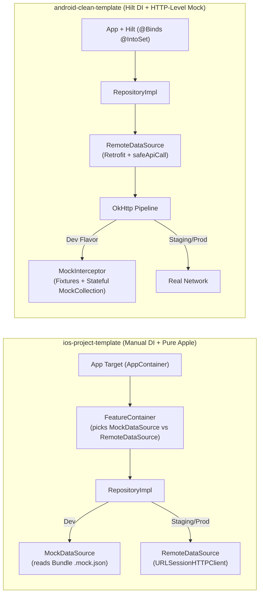

# Side-by-Side Comparison: `ios-project-template` vs. `android-clean-template`

Both templates share the same core DNA — **feature-first Clean Architecture (`domain` / `data` / `presentation` targets per feature), offline `dev` flavor, adaptive single-layout UI, unified `SessionCleaner` on logout, and AI-ready `.claude/skills`**.

However, when you compare them side by side, **`android-clean-template` is noticeably more mature as a "turnkey starter template"** (automation, mock engine, navigation, media/upload helpers, analytics, and performance testing), whereas **`ios-project-template` is stronger in zero-dependency self-reliance, strict DTO/domain data integrity, and security hardening**.

---

## 1. Head-to-Head Scorecard

| Category | `ios-project-template` | `android-clean-template` | Winner & Why |
| :--- | :---: | :---: | :--- |
| **1. "Day 1" New Project Setup** | **6.5 / 10** | **10 / 10** | 🏆 **Android**: Has `template.properties` + `new_project.sh --remove-catalog --reset-git`. iOS requires a manual 6-step rename across Xcode/plist/Swift files. |
| **2. Feature Scaffolding (`create_feature.sh`)** | **8.0 / 10** | **9.5 / 10** | 🏆 **Android**: Supports `--full-screen` vs tab, auto-wires `AppNavigation.kt` & Hilt `@IntoSet`, and includes `remove_feature.sh`. iOS still requires manual wiring in `AppContainer` and `MainTabView`/`RouteView`. |
| **3. Clean Architecture & Layer Enforcement** | **9.5 / 10** | **9.5 / 10** | 🤝 **Tie**: iOS uses SPM targets + `check_target_graph.sh` + `check_imports.sh` + `banned_api_check.sh`. Android uses Gradle modules + `internal` visibility + Konsist `:architecture-tests` + Detekt. |
| **4. Dev Mock Backend Engine** | **7.5 / 10** | **10 / 10** | 🏆 **Android**: `MockInterceptor` intercepts at the HTTP layer (so real Retrofit/serialization runs in dev!), supports stateful in-memory CRUD (`MockCollection`), query/page slicing, relative `{{date:-1}}` tokens, and `?__status=422`. iOS swaps out the whole DataSource (`*MockDataSource`) and skips `URLSessionHTTPClient` in dev. |
| **5. DTO & Mapper Contract Philosophy** | **9.5 / 10** | **7.5 / 10** | 🏆 **iOS**: iOS forbids silent defaults (`?: 0`, `orEmpty()`) on IDs, prices, and statuses—throwing `MappingError` on contract violations. Android makes every DTO field nullable and silently defaults missing values (`?: 0`, `orEmpty()`). |
| **6. Dependency Philosophy** | **9.5 / 10** | **8.5 / 10** | 🏆 **iOS**: 100% zero third-party dependencies (Apple frameworks only). Android uses standard industry libraries (Hilt, Retrofit/OkHttp, Room, Coil, Tink, Firebase, Roborazzi, Konsist). |
| **7. Navigation, Sheets & Result Passing** | **7.5 / 10** | **9.5 / 10** | 🏆 **Android**: Supports tabs, `FullScreenKey` (covering tab bar), stack-based sheet/dialog destinations, Typed `ResultEventBus` to return results from sheets, and tablet `NavigationSuiteScaffold` (rail + list-detail split). iOS has tabs + push + a single root `SheetRoute?` with no `fullScreenCover` or result bus. |
| **8. Media, Camera & Multipart Uploads** | **6.0 / 10** | **9.5 / 10** | 🏆 **Android**: Built-in `rememberPhotoPicker`, `rememberCameraCapture`, `ImageCompressor` (2048px, EXIF stripping), and streaming `multipartPart` upload. iOS has permission handlers and `ImagePipeline` for downloads, but no picker/camera wrappers, image compressor, or multipart upload in `HTTPClient`. |
| **9. Security & Device Integrity** | **9.5 / 10** | **8.0 / 10** | 🏆 **iOS**: Includes SPKI public-key pinning, App Attest, jailbreak/debugger/repackaging detection (`SecurityGuard`), biometric re-lock after background timeout, privacy screen, and AES-GCM `EncryptedFileStore`. |
| **10. Analytics, Crash & Performance Gates** | **7.5 / 10** | **10 / 10** | 🏆 **Android**: Has `AnalyticsTracker`/`CrashReporter` interfaces (with optional plug-and-play Firebase), Roborazzi screenshot tests, LeakCanary UI tests, Macro/Microbenchmarks, Baseline Profiles, JankStats, and an APK size gate. |

---

## 2. Deep Architectural Comparison

### 2.1 How Dev Mocking Works (Big Difference!)
- **In Android (`MockInterceptor`)**: The `dev` flavor **still executes the real `RemoteDataSource`, Retrofit interface, OkHttp interceptors, and error body parser**. `MockInterceptor` sits at the bottom of OkHttp, matches the URL/method/query to `fixtures/<feature>/GET_items.json` (or an in-memory stateful `MockCollection` for `POST`/`PATCH`/`DELETE`), adds a 400ms simulated delay so loading skeletons are visible, and returns an HTTP response.
- **In iOS (`*MockDataSource`)**: In `ProjectTemplate-Development`, `CatalogContainer` injects `CatalogMockDataSourceFactory`, which **bypasses `CatalogRemoteDataSource`, `CatalogEndpoint`, and `URLSessionHTTPClient` completely**!
  - *Consequence on iOS*: A bug in `CatalogEndpoint` (wrong path, query param, or HTTP method) or `CatalogRemoteDataSource` is **never exercised when running the Development scheme**, whereas on Android it is tested on every single dev run.
  - *Also on iOS*: Every feature needs 3 extra files (`*DataSourceFactory.swift`, `*MockDataSource.swift`, `*RemoteDataSource.swift`) just to switch between Mock and Remote.

### 2.2 DTO & Mapper Philosophy (Where iOS Wins Strongly)
- **Android's Rule #2**: *"Response DTOs are all-nullable with `= null` defaults. Mappers resolve every null (`orEmpty()`, `?: 0`)."*
  - *Risk*: If a backend bug sends `{"id": "123", "price": null}` in an e-commerce app, Android's `?: 0` silently displays the item as **$0.00 (Free)**!
- **iOS's Rule #2**: `ProductResponse+Entity.swift` strictly forbids defaulting IDs, money, quantities, statuses, or dates. It validates invariants (`price >= 0`, `discountPrice <= price`, `!id.isEmpty`) and throws `MappingError` → `ResponseError.invalidResponse`, logging the exact broken contract keypath without crashing or showing corrupt data. **iOS's approach here is much safer for fintech, ride-sharing, and e-commerce apps.**

### 2.3 Dependency Injection & Feature Registration
- **Android (Hilt + Gradle Auto-Discovery)**:
  - `settings.gradle.kts` uses a `ModulePaths` `ValueSource` to auto-discover every `feature/*/{domain,data,presentation}` module.
  - Features register their own tabs (`TopLevelDestination`), deep links (`DeepLinkPattern`), mock routes (`MockFeature`), and logout cleaners (`SessionCleaner`) using Hilt `@IntoSet`.
  - Adding or removing a feature touches **only 1 line** in `AppNavigation.kt` (automated by `create_feature.sh` and `remove_feature.sh`).
- **iOS (Manual Composition Root in `AppContainer`)**:
  - Zero third-party DI framework means fast compile times and crystal-clear stack traces, **but** adding a feature requires manually editing `AppContainer.swift` (adding container property, initializing it, registering Core Data model if any, registering `SessionCleanable` if any), `Route.swift`, `RouteView.swift`, `MainTabView.swift`, and `DeepLinkParser.swift`.
  - There is also no `remove_feature.sh` on iOS.

### 2.4 Error Handling & Screen State
- **iOS (`ErrorPolicy` + `ErrorHandling` + `FormState`)**:
  - iOS has a more centralized, ergonomic error-to-UI policy engine (`ErrorPolicy.swift`). A ViewModel calls `handle(error, context: .action, form: form)` and `ErrorPolicy` automatically maps HTTP 422 field errors onto `FormField` instances, triggers snackbars on pull-to-refresh failure while keeping old data, or triggers root maintenance/force-update screens.
- **Android (`AppResult<T>` + `UiState` + `Channel<Effect>`)**:
  - Android enforces that repositories never throw (`AppResult<T>`), and splits Compose UI into `<Name>Route` (stateful) and `<Name>Screen` (stateless, previewable, screenshot-testable).

---

## 3. What `ios-project-template` Should Steal from `android-clean-template`

If you want `ios-project-template` to reach the same turnkey maturity as `android-clean-template`, bring over these **7 ideas**:

1. **`template.properties` + `scripts/new_project.sh` + `scripts/remove_feature.sh`**
   - Just like Android's `new_project.sh`, create a script on iOS that reads a single config file, renames `ProjectTemplate`, bundle IDs, URL schemes, and background task IDs, optionally removes the sample `Catalog` feature (`--remove-catalog`), and resets git history (`--reset-git`).
2. **HTTP-Level Mock Interceptor Instead of Per-Feature `*MockDataSource`**
   - Move dev mocking into an `HTTPClient` decorator or `URLProtocol` / `RequestInterceptor` (like Android's `MockInterceptor`) with simulated latency (e.g. 300ms), query/pagination slicing, and stateful in-memory CRUD.
   - **Benefit**: Exercises `RemoteDataSource` and `Endpoint` in Development builds AND lets you delete `*DataSourceFactory` and `*MockDataSource` from every feature!
3. **`create_feature.sh` Auto-Wiring & `--full-screen` / `--route` Flags**
   - Update iOS's `create_feature.sh` so it also wires `AppContainer.swift` and `Route.swift` / `RouteView.swift` using marker comments (just like it already does for `Package.swift` and `L10n.swift`), and add a companion `scripts/remove_feature.sh`.
4. **Full-Screen Routes, Stack-Based Sheets & Result Passing in `AppRouter`**
   - Upgrade iOS's `AppRouter` to match Android's `Navigator`: support `fullScreenCover` routes, allow sheets to return typed results to the calling screen, and support iPad `NavigationSplitView` / sidebar rail properly.
5. **Dev Component Gallery Tab**
   - Android's `dev` flavor includes a **Component Gallery** tab showcasing every `DesignSystem` and `core:ui` component interactively. Adding a `DevGalleryScreen` (visible only in `ProjectTemplate-Development`) on iOS makes it effortless for developers and designers to inspect all 25+ `DesignSystem` components in one place.
6. **Photo Picker, Camera Capture, Image Compressor & Multipart Upload**
   - Port Android's media pipeline (`ImageCompressor` downscaling to 2048px + JPEG compression + EXIF GPS stripping, plus `MultipartFormData` streaming in `URLSessionHTTPClient`) into iOS `Core` & `DesignSystem`.
7. **Analytics & Crash Reporting Protocol (`AnalyticsTracker`)**
   - Port Android's `core/analytics` module pattern (`AnalyticsTracker` + `CrashReporter` protocols with debug console logger by default and optional Firebase / backend adapter) into iOS `Core`.

---

## 4. What `android-clean-template` Could Learn from `ios-project-template`

Conversely, the iOS template does a few things better that the Android template should adopt:
1. **Strict Mapper Validation Instead of Silent Null Defaulting**: Android's DTO mappers should validate required business invariants (like non-empty IDs and non-negative prices) and return `AppError.InvalidResponse` instead of silently substituting `?: 0` or `orEmpty()`.
2. **Centralized `ErrorPolicy` Context Table**: iOS's `ErrorPolicy.treatment(for: error, context: .initialLoad | .refresh | .pagination | .action)` guarantees that every screen in the app treats a pull-to-refresh error, an initial load error, a 422 validation error, or a 503 maintenance error identically without per-ViewModel boilerplate.
3. **Defense-in-Depth Shared Form & Domain Validation Rules**: iOS's `SharedDomain.Rules` + `FormState.applyServerErrors` seamlessly bridges client-side blur validation, UseCase validation, and HTTP 422 field error mapping.
4. **Device Integrity & Security Hardening**: iOS's `CertificatePinningDelegate`, biometric background re-lock timeout (`SessionManager`), privacy screen on app switcher, and `SecurityGuard` checks are more comprehensive out of the box.

