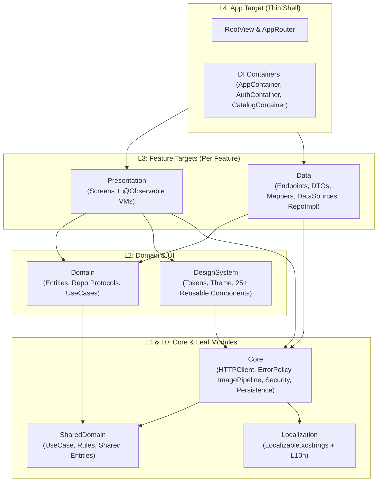

# Deep Architectural & Code Review: `ios-project-template`

## 1. Executive Verdict

**Is this a proper iOS project template to start new projects without starting from scratch?**

**Yes — with a 9.2 / 10 rating for medium-to-large production and enterprise iOS apps.**

This is not a toy boilerplate; it is one of the most cohesive, production-hardened, zero-dependency iOS 17+ / Swift 6 templates you will find. It solves the hardest parts of app infrastructure upfront: single-flight 401 token refresh, SPKI certificate pinning, offline-first caching with auto-retry, unified error policy routing, form validation linked to HTTP 422 field errors, downsampled image caching, privacy manifests, and compile-time layer enforcement.

However, **it has a few notable areas of over-engineering** (particularly in the `Data` layer and SPM target granularity) and **a few missing pieces** (most notably an automated project-renaming script, an analytics/feature-flag abstraction, and multipart upload support) that you should address so starting a new project takes 2 minutes instead of 45 minutes.

---

## 2. What This Template Gets Exceptionally Right

### 2.1 Compile-Time Architecture Enforcement (Not Just Convention)
Most Clean Architecture templates decay within 3 months because junior or rushed developers import `Data` models into SwiftUI views. This template makes architectural violations **impossible to merge** through three layers:
1. **SPM Target Isolation** (`Packages/AppModules/Package.swift`): `<F>Presentation` does not depend on `<F>Data`, and `<F>Domain` does not depend on `Core`.
2. **Declared Import Verification** (`scripts/check_imports.sh`): Uses `--explicit-target-dependency-import-check=error` to block implicit transitive imports that SwiftPM otherwise permits.
3. **Target Graph Linter** (`scripts/check_target_graph.sh`): Parses `swift package dump-package` with `jq` and `tsort` to prevent disallowed edges or cyclic domain dependencies.

### 2.2 First-Class Error Policy & Form Validation Pipeline
The error flow (`ResponseError.swift` → `ErrorPolicy.swift` → `ErrorHandling.swift`) is a standout design:
- ViewModels don't write ad-hoc `switch error` blocks; they call `handle(error, context: .action, form: form)` in one line.
- Depending on `ErrorContext` (`.initialLoad`, `.refresh`, `.pagination`, `.action`), the same error automatically routes to full-screen empty state, pull-to-refresh snackbar (preserving existing screen data), inline form fields (for HTTP 422), force-logout (401), or root blocking screen (426 Update Required / 503 Maintenance).
- `FormField` and `FormState` share validation rules (`Rules.swift`) with Domain UseCases and automatically map backend `422` field error dictionaries (`["phone": ["Already taken"]]`) directly under the matching input field.

### 2.3 Zero-Dependency Production Infrastructure
Instead of pulling in Alamofire, Kingfisher, KeychainAccess, and SwiftyBeaver, `Core` implements clean, testable, Swift-6-strict-concurrency equivalents in ~50–120 lines each:
- **Networking**: `URLSessionHTTPClient` (`@concurrent` decoding off the main actor) + interceptor chain + actor-isolated single-flight `TokenRefresher`.
- **Images**: Actor-backed `ImagePipeline` with in-flight deduplication, memory/disk LRU caches, prefetching, and `CGImageSource` downsampling (`ImageDownsampler`).
- **Security**: SPKI SHA-256 public key pinning (`CertificatePinningDelegate`), AES-GCM `EncryptedFileStore`, biometric session re-lock, first-launch Keychain wipe, and device-integrity signals (`SecurityGuard`).

### 2.4 Scaffolding & AI Agent Integration
- `scripts/create_feature.sh` generates Domain/Data/Presentation targets, unit test targets, DI container, mock JSON, `L10n` entries, and `.xctestplan` entries in seconds.
- Pre-configured `.claude/skills` and `.claude/agents` encode team conventions so AI coding assistants generate compliant slices out of the box.

---

## 3. What Is Over-Engineered (And Creates Unnecessary Friction)

> [!WARNING]
> While the strictness protects code quality in large teams, several layers introduce ceremony without proportional benefit.

### 3.1 Four Layers of Indirection Inside `<Feature>Data`
Currently, a single API call in a feature's `Data` module goes through:
`RepositoryImpl` → `DataSourceFactory` (protocol + 2 structs) → `DataSource` (protocol) → `RemoteDataSource` / `MockDataSource` → `HTTPClient` / `MockDataHelper`.

- **Why `DataSourceFactory` is redundant**: `RepositoryImpl` calls `factory.makeAuthDataSource()` once in `init`. Passing `any AuthDataSource` directly into `AuthRepositoryImpl(dataSource:)` from `AuthContainer` eliminates 3 types (`*DataSourceFactory`, `*MockDataSourceFactory`, `*RemoteDataSourceFactory`) per feature with zero loss of testability or flexibility.
- **Even simpler**: Since `HTTPClient` is already a protocol, a `MockHTTPClient` (which loads `<feature>-*.mock.json` based on `Endpoint`) in `Development` flavor could eliminate `*MockDataSource` per feature entirely, unless a feature needs stateful mock behavior.

### 3.2 6 SPM Targets Per Feature (Scaling Bottleneck at 20+ Features)
Every time you run `scripts/create_feature.sh`, `Package.swift` gains **6 targets** (`<F>Domain`, `<F>Data`, `<F>Presentation`, and 3 test targets).
- For 5–10 features (30–60 targets), this is fast and clean.
- For a real commercial app with 25–35 features (150–210 targets in a single `Package.swift`), Xcode's SourceKit-LSP indexing, SwiftPM dependency resolution, and clean build linking times degrade noticeably.

### 3.3 Pass-Through UseCases (`GetProductsUseCase`, `GetProductDetailsUseCase`)
In `Auth`, `LoginUseCase` re-runs validation rules (which justifies its existence). In `Catalog` (and in `scripts/feature_template`), `GetProductsUseCase` and `GetProductDetailsUseCase` are 1-line pass-through wrappers around `CatalogRepository`. Enforcing 1-UseCase-per-repository-method as a mandatory rule creates boilerplate files for simple GET endpoints.

### 3.4 `TokenRefreshBridge` & Duplicate Token Types
Because `TokenRefresher` lives in `Core` and `RefreshSessionUseCase` lives in `AuthDomain`, the app target has to wire them together with a mutable `TokenRefreshBridge` and map `AuthTokensEntity` (`AuthDomain`) to `AuthTokens` (`Core`). Moving `AuthTokens` to `SharedDomain` removes the bridge and duplicate struct.

### 3.5 Overly Aggressive Regex Bans in `banned_api_check.sh`
`scripts/banned_api_check.sh` bans `.onTapGesture` across all Swift files without a bypass comment (like `// crash-safe:` has for `!`). Legitimate uses of `.onTapGesture(count: 2)` (double-tap to zoom an image) or coordinate-aware `.onTapGesture { location in ... }` will fail pre-commit and CI unless the script is edited.

---

## 4. What Is Missing (Crucial Gaps for a Reusable Starter Template)

### 4.1 Missing `scripts/init_project.sh` (Automated Template Renaming)
Right now, `README.md` lists a **manual 6-step checklist** to start a new project:
- Manually renaming `ProjectTemplate` in `ios-project-template.xcodeproj/project.pbxproj`, schemes, and `.xctestplan`
- Updating `BASE_BUNDLE_IDENTIFIER` and `PRODUCT_NAME` in `Config/Base.xcconfig`
- Updating `BGTaskSchedulerPermittedIdentifiers` and `CFBundleURLSchemes` in `Info.plist`
- Updating `BackgroundTaskID.swift`, `DeepLinkConstants.swift`, `KeychainService`, `AppLogger` subsystem, and `PersistenceController` name (`"ProjectTemplate"`).

### 4.2 Missing Analytics & Crash Breadcrumb Abstraction
The template has `AppLogger` (OSLog) and `MetricsCollector` (MetricKit), which are great for system diagnostics, but commercial apps need product analytics and funnel tracking (`AnalyticsTracker` protocol + composite dispatcher).

### 4.3 Missing Feature Flags / Remote Config & Launch Version Check
- `RootView.swift` supports `.blocked(.maintenance)` and `.blocked(.updateRequired)`, but those states are only triggered if an API endpoint returns HTTP `426` or `503`. Adding a lightweight `RemoteConfigService` / `FeatureFlagEvaluating` protocol fetched during `AppContainer.bootstrap()` allows checking minimum supported app version, maintenance mode, and feature toggles at launch.

### 4.4 Missing Multipart / File Upload & Download Progress in `HTTPClient`
- `Endpoint.swift` only supports `var body: (any Encodable & Sendable)?` encoded as `application/json`. Adding `MultipartFormData` and `upload(_ endpoint: any Endpoint, data: Data) async throws -> Response` to `HTTPClient` will prevent teams from hacking around `URLSessionHTTPClient` in every new project.

### 4.5 Navigation & Modal Limitations in `AppRouter`
1. **No `fullScreenCover` support**: Only `.appSheet(item: $router.sheet)` exists.
2. **Sheets don't receive `AppContainer`**: `SheetRouteView(sheet: $0, router: router)` is not passed `container`, nor is it wrapped in a `NavigationStack` if a sheet needs multi-step push navigation.

---

## 5. Folder Structure Evaluation (9 / 10)

### What Works Well
- **Zero `.pbxproj` Merge Conflicts**: Keeping `App/` as a thin shell and 95% of code inside `Packages/AppModules/Sources/` means SwiftPM discovers files automatically by folder.
- **Feature-First Slicing**: `Sources/Features/<Feature>/{Domain,Data,Presentation}` keeps feature code cohesive.
- **Screen-First Grouping in `Presentation/`**: Grouping `<Screen>Screen.swift` and `<Screen>ViewModel.swift` together per screen scales cleanly.
- **Smart `App/Resources/Mock/` Placement**: Keeping `*.mock.json` in `App/Resources/Mock/` allows `EXCLUDED_SOURCE_FILE_NAMES = *.mock.json` in `Base.xcconfig` to strip mock files from Staging and Production builds automatically.

### Three Folder Adjustments Recommended
1. **Flatten 1-File Subfolders Inside `<Feature>/Data`**: `Sources/Features/Auth/Data/` currently has 9 folders for 9 files (`DataSource/Factory`, `DataSource/Mock`, `DataSource/Remote`, `Model/Request`, `Model/Response`, etc.). Flattening `DataSource/` and `Model/` reduces sidebar clicking in Xcode.
2. **Group Feature Tests Under `Tests/Features/<Feature>/`**: Currently `Packages/AppModules/Tests/` is a flat list (`AuthDataTests`, `AuthDomainTests`, `AuthPresentationTests`, etc.). Mirroring `Sources/Features/<Feature>/` under `Tests/Features/<Feature>/` prevents 60+ sibling folders when the app grows to 20 features.
3. **Move `ProductCard.swift` Out of `DesignSystem`**: Keep `DesignSystem` 100% domain-agnostic by moving e-commerce-specific components like `ProductCard` into `CatalogPresentation`.

---

## 6. Subtle Code Issues Found

1. **Throwaway ViewModel Allocations on Parent Re-renders**:
   In `MainTabView.swift`, `RootView.swift`, and `RouteView.swift`, `Screen(viewModel: container.catalog.make...ViewModel())` evaluates the argument expression eagerly on every parent view redraw, allocating and immediately deinitializing a duplicate ViewModel (since `@State(initialValue:)` inside the screen retains the first instance). Passing `@autoclosure () -> ViewModel` into `Screen.init` avoids this allocation.
2. **Regional Defaults Baked Into Shared Modules**:
   Bangla (`bn`) and `Rules.phoneBD` are hardcoded defaults in `create_feature.sh`, `LocalizationTests.swift`, and `LoginViewModel.swift`.
3. **Strict `.xcode-version` Check in `setup.sh`**:
   `setup.sh` fails if `xcodebuild -version` does not match `.xcode-version` (`27.1`) character-for-character, which can block developers after minor Xcode patch updates.

